  <!-- Hero Card -->
  
    

  <!-- ASCII Art -->
  
    

  <!-- Info Tiles -->
  
  
  
    

  <!-- Daily Commit Clock -->
  
    

  <!-- Contribution Stats -->
  
    

  <!-- Featured Projects -->
  
  
   
  
  

