  <!-- Hero Card -->
  
    

  <!-- Animated ASCII Portrait -->
  
    

  <!-- Linked Focus Tiles -->
  
  
  
    

  <!-- Daily Commit Clock -->
  
    

  <!-- Monthly Contribution Metrics -->
  
    

  <!-- Featured Projects -->
  
  
   
  
  
    

  <!-- Contribution Graph -->
  

